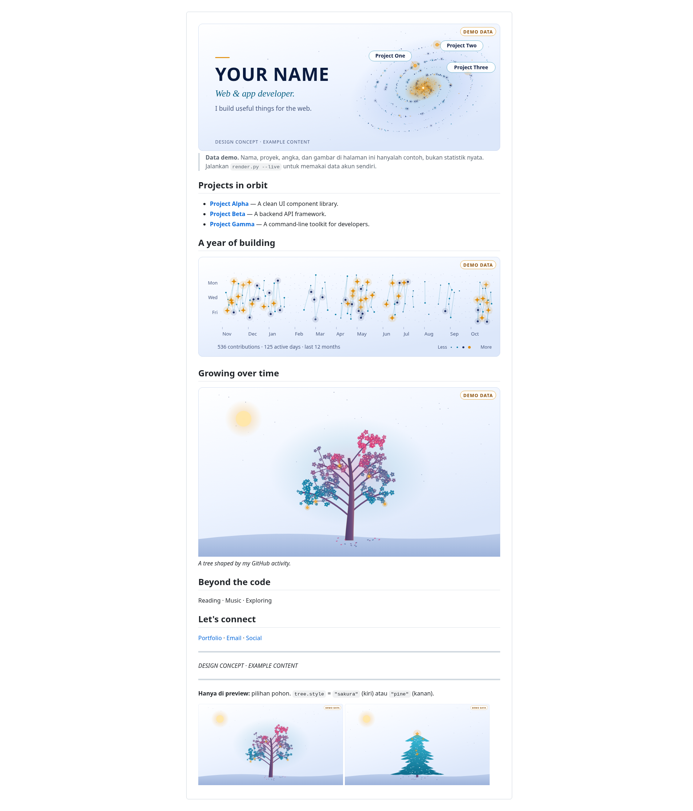
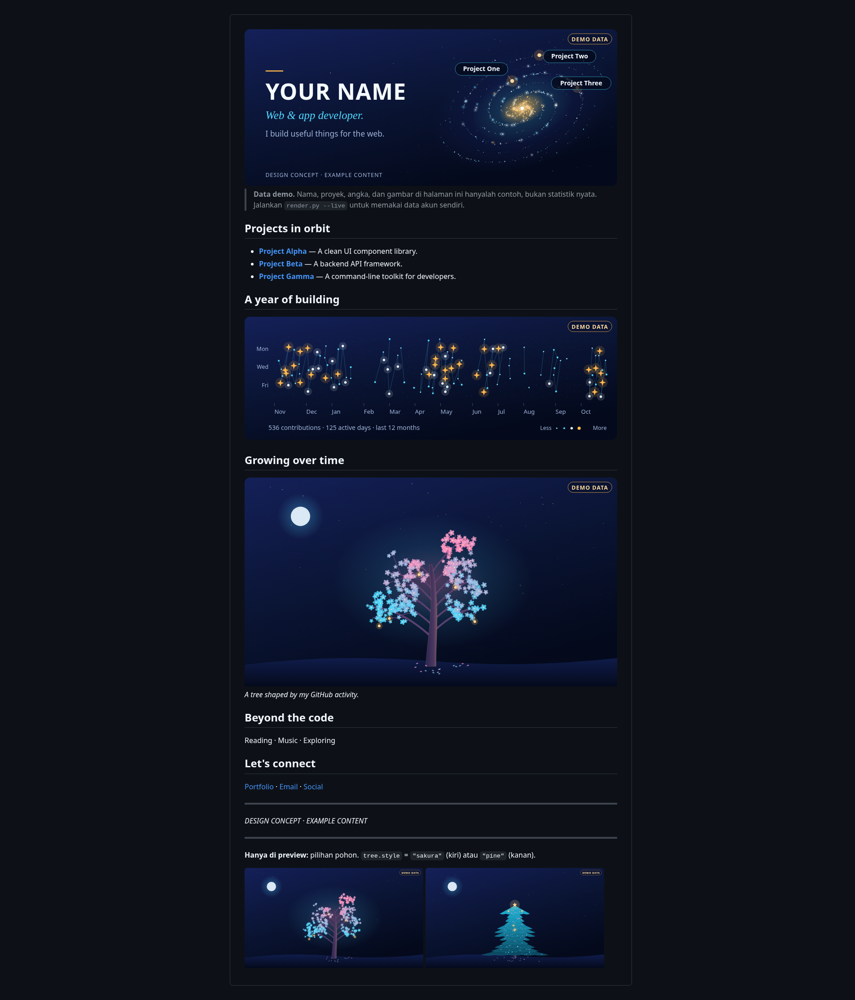

# dev-readme-kit

Kumpulan template README profil GitHub dengan data contoh yang jelas ditandai. Tanpa tumpukan badge, tanpa statistik palsu, tanpa dependensi berat.

| Varian | Tampilan | Data | Panduan |
| :-- | :-- | :-- | :-- |
| **Dasar** (`template/`) | header terminal, `whoami`, proyek dengan cerita pendek, minat, kontak; terang/gelap otomatis | ditulis manual | bagian di bawah |
| **Galaxy** (`galaxy/`) | hero dengan spiral galaksi, konstelasi kontribusi, pohon pertumbuhan; varian dark dan light asli (`<picture>`) | config + data GitHub harian (Actions) | [docs/galaxy.md](docs/galaxy.md) |

## Preview varian galaxy

<picture>
  <source media="(prefers-color-scheme: dark)" srcset="docs/previews/galaxy-animated-dark.svg">
  
</picture>

Gambar di atas berganti otomatis mengikuti tema GitHub-mu (terang atau gelap). Bintang berkelip dan cincin orbit berputar pelan; animasinya murni CSS di dalam SVG, tanpa JavaScript, dan berhenti bila sistemmu meminta gerak minimal (*reduce motion*). Semua angka, nama, dan proyek adalah **data demo**, ditandai lencana *DEMO DATA*. Animasi dibuat dari renderer yang sama dengan aset varian galaxy (`render.py --preview-svg`) dan diperiksa dengan `scripts/cek-animasi.py`. Aset itu hanya dilihat lewat pemeriksaan statis; cara GitHub menampilkan animasinya belum dikonfirmasi.

<details>
<summary>Tangkapan layar statis (terang dan gelap)</summary>

| Terang | Gelap |
| :-: | :-: |
| [](docs/previews/preview-galaxy-light.png) | [](docs/previews/preview-galaxy-dark.png) |

Klik gambar untuk ukuran penuh. Bagian "Hanya di preview" di dasar gambar menampilkan dua opsi pohon (sakura dan pine); README asli hanya memuat satu sesuai `tree.style`.

</details>

> Semua isi kedua varian adalah **data contoh**. Varian dasar menandainya dengan `‹seperti ini›`; varian galaxy memakai `YOUR NAME`, `YOUR-USERNAME`, `example.com` dan lencana **DEMO DATA** pada gambar.

## Isi

```text
template/                      # varian dasar
├── README.md
└── assets/header-{light,dark}.svg
galaxy/                        # varian galaxy
├── README.md                  # blok <!-- galaxy:... --> diisi renderer
├── galaxy.config.json         # identitas, proyek, gaya pohon, mode data
├── scripts/render.py          # renderer SVG orisinal (Python, pustaka standar)
├── assets/                    # hasil render DEMO, tiap gambar dalam -dark dan -light
│                              #   hero, constellation, tree (+ tree-sakura/tree-pine)
└── .github/workflows/update-galaxy.yml
docs/galaxy.md                 # panduan varian galaxy: pemasangan, pemetaan data, izin
docs/previews/                 # galaxy-animated-{dark,light}.svg (utama) + PNG statis
scripts/
├── buat-header.py             # membuat ulang SVG header varian dasar
├── cek-placeholder.sh         # memeriksa sisa data contoh (varian dasar)
├── cek-animasi.py             # verifikasi statis SVG animasi (CSS, reduced-motion, desain tak berubah)
└── buat-preview.mjs           # membangun preview HTML terang/gelap
preview/                       # preview-{light,dark}.html (dasar), preview-galaxy-*.html, preview-animated-*.html
```

## Preview HTML

Selain PNG di atas, repo ini membawa preview HTML. Unduh atau clone repo, lalu buka berkas di browser (path relatif, tanpa server):

| | Terang | Gelap |
| :-- | :-- | :-- |
| Dasar | `preview/preview-light.html` | `preview/preview-dark.html` |
| Galaxy | `preview/preview-galaxy-light.html` | `preview/preview-galaxy-dark.html` |

Preview memakai CSS gaya GitHub, jadi mendekati tetapi tidak identik dengan render GitHub sungguhan. PNG di atas adalah tangkapan layar dari preview HTML galaxy, bukan dari halaman profil GitHub yang sebenarnya.

## Pemasangan varian dasar

README profil hanya tampil jika repositorinya **bernama persis sama dengan username GitHub-mu** dan berstatus **publik**.

1. Buat repositori publik bernama `USERNAME`, lalu clone.
2. Salin isi `template/` ke akar repositori itu:

   ```sh
   cp -R dev-readme-kit/template/. USERNAME/
   ```

3. Ubah header: edit blok `KONTEN` di `scripts/buat-header.py` (salin skripnya ke repositorimu), lalu jalankan

   ```sh
   python3 scripts/buat-header.py --out assets/
   ```

4. Ganti semua teks `‹...›` di `README.md` (cari dengan `‹` di editor) dan hapus komentar `GANTI`.
5. Periksa sisa data contoh; kode keluar `0` berarti bersih:

   ```sh
   sh scripts/cek-placeholder.sh
   ```

6. Commit dan push.

Tanpa Python? Buka kedua SVG di `assets/` dengan editor teks dan ubah elemen `<text>` secara manual, pada kedua file.

Varian galaxy punya langkah pemasangan sendiri di [docs/galaxy.md](docs/galaxy.md).

## Status dan catatan jujur

- **Data demo vs live.** Semua gambar dan angka yang ada di repo ini dibuat dengan `--demo` (generator deterministik, tanpa jaringan). Itu bukan statistik siapa pun. Mode `--live` mengambil data nyata dari `api.github.com` dan menolak berjalan selama config masih berisi data contoh. Panduannya ada di [docs/galaxy.md](docs/galaxy.md).
- **GitHub Actions harian belum diuji di GitHub.** `galaxy/.github/workflows/update-galaxy.yml` adalah template. Di repo ini ia **tidak aktif**, karena GitHub hanya menjalankan workflow dari `.github/workflows/` di akar repositori. Workflow baru berjalan setelah kamu menyalinnya ke repositori profilmu, dan belum pernah dijalankan di sana. Akses `GITHUB_TOKEN` bawaan ke kalender kontribusi juga belum diverifikasi. Uji dengan **Run workflow** (`workflow_dispatch`) sebelum mengandalkan jadwal harian.
- **Tampilan.** Aset divalidasi sebagai XML dan dicek batas koordinat, kontras, ukuran font, serta determinismenya. Penampilan di halaman profil GitHub sungguhan belum dibandingkan dengan preview.
- **Ponsel.** Gambar SVG mengecil mengikuti lebar layar, jadi teks di dalamnya kecil di ponsel. Nama dan daftar proyek tetap tersedia sebagai teks Markdown.

## Panduan isi

| Bagian | Saran |
| :-- | :-- |
| `whoami` | 3–5 baris di blok kode + paragraf maksimal 3 kalimat |
| Proyek pilihan | 2–4 proyek; tiap proyek: fungsi (1 kalimat) + cerita (2 kalimat) |
| Minat | 4–6 butir yang jujur, bukan daftar teknologi |
| Kontak | hanya kanal yang benar-benar kamu pakai |

Tulis hanya data nyata. Jangan menaruh angka, bintang, atau statistik yang tidak bisa kamu pertanggungjawabkan.

## Kompatibilitas render GitHub

Kedua varian memakai Markdown standar ditambah gambar SVG yang disimpan di repo dan dimuat lewat ``. Varian dasar juga memakai HTML yang diizinkan GitHub (`<div align>`, `<picture>`, `<source>`, `<sub>`, `<code>`) untuk mode gelap otomatis; varian galaxy hanya Markdown dan SVG.

Yang sengaja dihindari: `<style>`, `<script>`, `<iframe>`, JavaScript di halaman, font eksternal, dan gambar dari layanan luar. Animasi kedip di SVG mati bila pengguna meminta *reduced motion*. Detail varian galaxy ada di [docs/galaxy.md](docs/galaxy.md).

## Kredit dan inspirasi

**Varian dasar:** ide umum (header bergaya terminal, judul bagian bergaya perintah shell, bio singkat sebagai `whoami`, daftar proyek ringkas) terinspirasi dari pola yang lazim pada profil [PeterGabaldon](https://github.com/PeterGabaldon/PeterGabaldon), [liyown](https://github.com/liyown/liyown), dan [v1br](https://github.com/v1br/v1br). Tidak ada teks, gambar, aset, atau identitas mereka yang disalin.

**Varian galaxy:** terinspirasi secara konsep oleh [vinimlo/galaxy-profile](https://github.com/vinimlo/galaxy-profile) (GPL-3.0; kodenya tidak dibaca atau disalin supaya kit ini tetap MIT), [m3hrab/github-constellation](https://github.com/m3hrab/github-constellation) (MIT), dan [egorthinks/git-bonsai](https://github.com/egorthinks/git-bonsai) (MIT). Renderer dan aset ditulis dari nol.

**Preview:** HTML preview menyematkan `github-markdown-css` (MIT, © Sindre Sorhus).

## Lisensi

[MIT](LICENSE). Kamu bebas memakai, mengubah, dan menyebarkan kit ini. Baris kredit di kaki template boleh dihapus.
