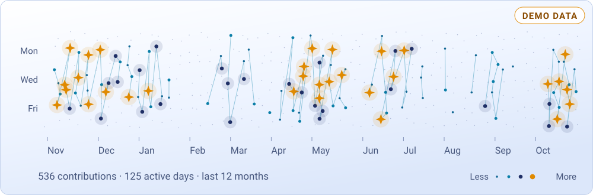

<!-- galaxy:hero:start -->
<picture>
  <source media="(prefers-color-scheme: dark)" srcset="assets/hero-dark.svg">
  
</picture>
<!-- galaxy:hero:end -->

<!-- galaxy:notice:start -->
> **Data demo.** Nama, proyek, angka, dan gambar di halaman ini hanyalah contoh, bukan statistik nyata. Jalankan `render.py --live` untuk memakai data akun sendiri.
<!-- galaxy:notice:end -->

## Projects in orbit

<!-- galaxy:projects:start -->
- **[Project Alpha](https://github.com/YOUR-USERNAME/project-alpha)** — A clean UI component library.
- **[Project Beta](https://github.com/YOUR-USERNAME/project-beta)** — A backend API framework.
- **[Project Gamma](https://github.com/YOUR-USERNAME/project-gamma)** — A command-line toolkit for developers.
<!-- galaxy:projects:end -->

## A year of building

<!-- galaxy:constellation:start -->
<picture>
  <source media="(prefers-color-scheme: dark)" srcset="assets/constellation-dark.svg">
  
</picture>
<!-- galaxy:constellation:end -->

## Growing over time

<!-- galaxy:tree:start -->
<picture>
  <source media="(prefers-color-scheme: dark)" srcset="assets/tree-dark.svg">
  
</picture>
<!-- galaxy:tree:end -->

*A tree shaped by my GitHub activity.*

## Beyond the code

<!-- galaxy:beyond:start -->
Reading · Music · Exploring
<!-- galaxy:beyond:end -->

## Let's connect

<!-- galaxy:connect:start -->
[Portfolio](https://example.com) · [Email](mailto:you@example.com) · [Social](https://example.com/social)
<!-- galaxy:connect:end -->

---

<!-- galaxy:footer:start -->
_DESIGN CONCEPT · EXAMPLE CONTENT_
<!-- galaxy:footer:end -->
