<!--
  TEMPLATE README PROFIL GITHUB — dev-readme-kit
  Semua teks bertanda ‹seperti ini› adalah DATA CONTOH. Ganti, lalu hapus tanda ‹ ›.
  Cari sisa placeholder:  sh scripts/cek-placeholder.sh README.md
  Hapus semua komentar bertanda GANTI setelah selesai (opsional, tidak tampil di GitHub).
-->

<!-- GANTI: header dibuat dari scripts/buat-header.py (edit KONTEN di sana, jalankan ulang). -->
<div align="center">
  <picture>
    <source media="(prefers-color-scheme: dark)" srcset="assets/header-dark.svg">
    
  </picture>
</div>

## `whoami`

<!-- GANTI: 3–5 baris. Biarkan di dalam blok kode agar tampil rapi di mode terang & gelap. -->
```text
nama     : ‹Nama Kamu›
peran    : ‹peran singkat›
lokasi   : ‹Kota, Negara›
sekarang : ‹hal yang sedang dikerjakan›
tanya-aku: ‹topik yang senang dibahas›
```

<!-- GANTI: satu paragraf pendek, maksimal 3 kalimat, orang pertama. -->
Saya ‹peran› yang suka ‹hal yang disukai›. Saat ini saya sedang ‹kegiatan saat ini›,
dan senang mengobrol soal ‹topik›.

---

## `ls ~/proyek-pilihan`

<!-- GANTI: 2–4 proyek. Pola tiap proyek: tautan, satu kalimat fungsi, cerita 2 kalimat, tag teknologi. -->

### [‹nama-proyek-1›](https://github.com/‹username-kamu›/‹nama-proyek-1›)

‹Satu kalimat: proyek ini melakukan apa.›

> **Ceritanya:** ‹Masalah apa yang memicu proyek ini dibuat.› ‹Apa yang paling kamu pelajari darinya.›

`‹bahasa›` · `‹alat›` · `‹status: aktif / arsip›`

### [‹nama-proyek-2›](https://github.com/‹username-kamu›/‹nama-proyek-2›)

‹Satu kalimat: proyek ini melakukan apa.›

> **Ceritanya:** ‹Latar belakang singkat.› ‹Pelajaran atau hasil yang dicapai.›

`‹bahasa›` · `‹alat›` · `‹status›`

### [‹nama-proyek-3›](https://github.com/‹username-kamu›/‹nama-proyek-3›)

‹Satu kalimat: proyek ini melakukan apa.›

> **Ceritanya:** ‹Latar belakang singkat.› ‹Pelajaran atau hasil yang dicapai.›

`‹bahasa›` · `‹alat›` · `‹status›`

---

## `cat minat.txt`

<!-- GANTI: 4–6 butir. Tulis yang benar-benar kamu minati, bukan daftar teknologi. -->
- ‹Minat 1, mis. sistem terdistribusi›
- ‹Minat 2, mis. tooling developer›
- ‹Minat 3, mis. dokumentasi yang enak dibaca›
- ‹Minat 4, di luar kode, mis. fotografi›

---

## `ping kontak`

<!-- GANTI: sisakan hanya kanal yang benar-benar kamu pakai. Domain example.com hanya contoh. -->
| Kanal | Tujuan |
| :-- | :-- |
| Surel | [‹nama›@example.com](mailto:‹nama›@example.com) |
| Situs / blog | [‹example.com/blog›](https://example.com/blog) |
| Profil lain | [‹example.com/profil›](https://example.com/profil) |

<!-- GANTI: tulis jam atau zona waktu hanya jika kamu mau. Hapus baris ini jika tidak perlu. -->
Waktu balas biasanya ‹mis. 1–2 hari kerja›, zona waktu ‹WIB›.

---

<div align="center">
  <sub><code>‹username-kamu›@dev:~$ exit</code> · dibuat dengan <a href="https://github.com/‹username-kamu›/dev-readme-kit">dev-readme-kit</a> · MIT</sub>
</div>
